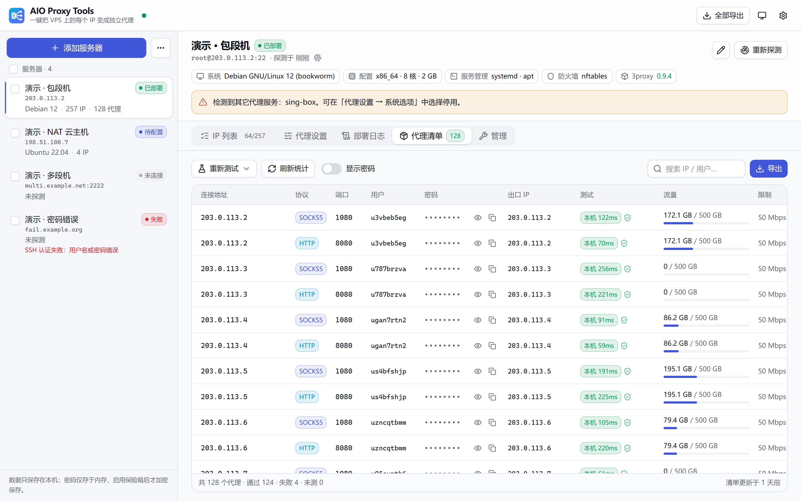
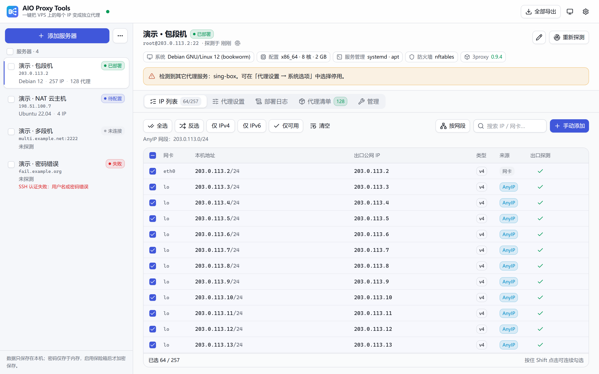
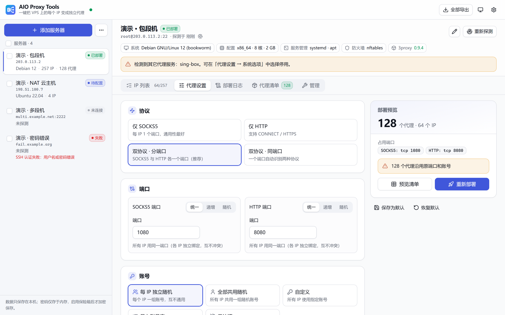
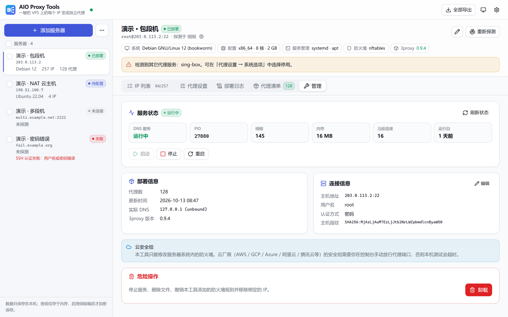
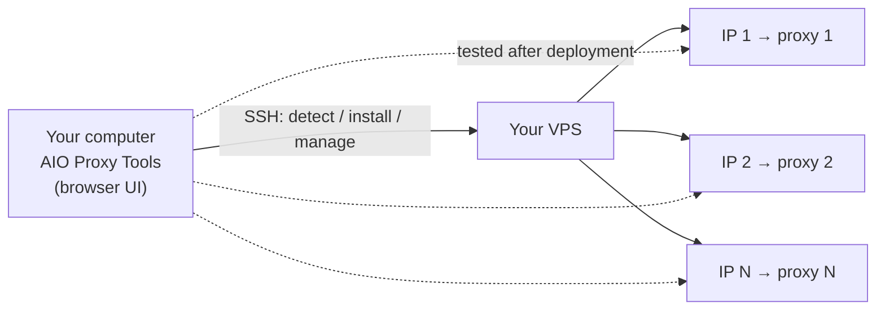

<div align="center">


# AIO Proxy Tools

**One server, every IP, its own proxy: set them all up in one click.**

Enter your SSH details and it finds every IP on the server. Pick a protocol and an account scheme, then deploy, test and export in one step.

[](https://github.com/Ryan-Laws/AIO-Proxy-Tools/releases)
[](https://github.com/Ryan-Laws/AIO-Proxy-Tools/actions/workflows/ci.yml)
[](LICENSE)


**English** · [简体中文](README.zh-CN.md)

<br>

<picture>
  <source media="(prefers-color-scheme: dark)" srcset="docs/assets/screenshot-proxies-dark.png">
  
</picture>

</div>

> [!NOTE]
> The user interface is currently available in **Simplified Chinese** only. This README describes each screen so you can follow along.

---

## Why AIO Proxy Tools

Turning a multi-IP VPS into one proxy per IP usually means a lot of manual work:

1. Log in and go through the network interfaces one by one.
2. Write the proxy config by hand: bind a port to each IP and set up the accounts.
3. Configure the firewall and sort out DNS.
4. Test every proxy, one at a time.

With dozens or hundreds of IPs, that's slow and easy to get wrong.

**AIO Proxy Tools turns the whole process into a few clicks.** Download it and double-click to run. The interface opens in your browser. There's nothing to install, and nothing to set up on the server beforehand.

| | |
|---|---|
| 🧭 **Auto-detection** | OS, CPU architecture, firewall, every IPv4 / IPv6 address, cloud NAT (private IP on the interface, public IP outside) and whole subnets routed to the host (AnyIP) |
| 🔀 **One IP in, same IP out** | Each IP listens on its own, and traffic leaves through the IP it came in on. Accounts are isolated from each other |
| 🧩 **Any protocol mix** | SOCKS5 only, HTTP(S) only, both protocols on separate ports, or both on a single shared port |
| 🔑 **Flexible accounts** | A random account per IP, one shared account, your own credentials, an imported list, or no password with a source-IP allowlist |
| 📊 **Limits and traffic** | Per-account bandwidth caps, connection limits, daily / weekly / monthly traffic quotas and expiry dates, with live traffic stats |
| 🚀 **Batch deployment** | Add dozens of servers at once (paste a list or import a CSV), deploy them in parallel, export everything together |
| ✅ **Tested from your machine** | After deployment, every proxy is tested from your computer: does it connect, is the exit IP correct, are requests without a password rejected |
| 🛡️ **Secure by default** | No stored passwords, SSH host-key checking, no access to private networks through the proxy, no client-IP headers, no telemetry |

## Screenshots

<table>
  <tr>
    <td width="50%"><p align="center"><b>IP list</b>: every IP and its public exit IP, pick the ones to use</p></td>
    <td width="50%"><p align="center"><b>Proxy settings</b>: protocol, ports, accounts and limits, with a live preview</p></td>
  </tr>
  <tr>
    <td width="50%"><p align="center"><b>Proxy list</b>: test results, traffic usage, one-click export</p></td>
    <td width="50%"><p align="center"><b>Manage</b>: service status, start / stop / restart, one-click uninstall</p></td>
  </tr>
</table>

> Screenshots were taken in the built-in demo mode. All addresses shown are reserved documentation addresses.

## Quick start

### 1. Download

Get the archive for your system from [Releases](https://github.com/Ryan-Laws/AIO-Proxy-Tools/releases) and unpack it. There are no dependencies to install.

| System | File |
|---|---|
| Windows | `aio-proxy-tools-*-windows-amd64.zip` (`windows-arm64` for ARM devices) |
| macOS | `aio-proxy-tools-*-darwin-arm64.tar.gz` (Apple silicon) / `darwin-amd64` (Intel) |
| Linux | `aio-proxy-tools-*-linux-amd64.tar.gz` / `linux-arm64` |

Each release includes a `SHA256SUMS` file so you can check the download.

### 2. Run

- **Windows**: double-click `aio-proxy-tools.exe`.
- **macOS / Linux**: run `./aio-proxy-tools` in a terminal.

A console window opens and the interface opens in your default browser. **Keep the console window open while you work.** Closing it quits the app.

> **First launch on macOS**: the app isn't signed by Apple. Open *System Settings → Privacy & Security* and click *Open Anyway*, or run `xattr -d com.apple.quarantine ./aio-proxy-tools`.

### 3. Deploy

In the interface:

1. **Add server** (添加服务器): enter the IP, SSH port, username, and a password or private key.
2. **IP list** (IP 列表): once detection finishes, tick the IPs you want to turn into proxies.
3. **Proxy settings** (代理设置): choose the protocol, ports and accounts, then click **Deploy** (开始部署).
4. **Proxy list** (代理清单): when deployment finishes, every proxy is tested automatically. Copy or export the results from here.

Want to look around without a server? Click **Load demo data** (载入演示数据) on the start screen.

## User guide

### Adding servers

- **Login**: password or OpenSSH private key (with optional passphrase). Use root, or a regular user with sudo.
- **Batch add**: click `⋯` next to *Add server*, then paste one server per line as `host[:port] [user] [password]` (space-separated), or import a CSV file. Servers are probed as soon as they're added.
- **Host keys**: the server's host key is recorded on first connection. If it changes later, the connection is refused to prevent man-in-the-middle attacks. If you reinstalled the server, you can confirm and trust the new key from the interface.

### Choosing IPs

After detection, the IP list shows:

- each IP's network interface, type (v4 / v6) and source (interface or AnyIP subnet);
- the **public exit IP** measured for each one.

You can filter by subnet, show only IPv4 or IPv6, or show only working IPs. Shift-click selects a range.

### Proxy settings

| Setting | Options |
|---|---|
| Protocol | SOCKS5 only · HTTP only · Both on separate ports (recommended) · Both on one port |
| Ports | Set per protocol: one **shared** port for every IP / **incrementing** per IP / **random**. Any row can also be edited individually in the preview |
| Accounts | Random per IP · One shared random account · Custom · Import a list · No auth (a source-IP allowlist is required) |
| Limits | Per-account bandwidth (Mbps), max concurrent connections, daily / weekly / monthly traffic quota, expiry date |
| DNS | Local recursive (default) · Local cache + forwarding · Public DNS · System resolver · Custom |
| System options | Open firewall ports · Enable BBR · Kernel tuning · Block private networks · Keep existing ports and accounts on redeploy · Stop conflicting proxy services · SOCKS5 UDP (experimental) · Connection logging (off by default) · GitHub mirror |

The **deployment preview** on the right updates as you go. It shows how many proxies will be created, which ports they use, and anything that needs your attention. Click **Preview list** to see every proxy's details before you deploy.

Click **Save as default** to reuse the current settings for servers you add later.

### Deploying and testing

When you click **Deploy**, the app does the following over SSH. Progress streams live to the **Deployment log** (部署日志) tab:

1. Installs 3proxy, downloaded from the official source and checked against its SHA256.
2. Sets up a DNS resolver.
3. Binds the IPs and writes the configuration.
4. Configures the firewall and registers a system service.

After deployment, every proxy is tested from your computer. If the server's self-test passes but your computer can't connect, the app tells you so: open the proxy ports in your cloud provider's **security group**.

### Exporting

Click **Export** on the proxy list, or **Export all** at the top to export every server at once. Formats:

- `ip:port:user:pass`
- `user:pass@ip:port`
- `socks5://user:pass@ip:port` / `http://...` URLs
- CSV
- A custom template, e.g. `{proto}://{user}:{pass}@{host}:{port}`

You can export a single protocol only, or only the proxies that passed testing.

### Managing and uninstalling

On the **Manage** (管理) tab you can:

- see the service status, current connections and memory use;
- start, stop or restart the proxy service;
- change settings and redeploy without dropping active connections.

**Uninstall** stops the service, removes its files, and reverts the firewall rules and IP bindings the app added, leaving the server as it was before.

## Command-line mode

For headless machines or automation scripts:

```bash
export AIO_SSH_PASSWORD='your-ssh-password'   # read from the environment, stays out of shell history
./aio-proxy-tools deploy -host 203.0.113.10 -protocol dual -auth per -out proxies.txt
./aio-proxy-tools test -host 203.0.113.10
./aio-proxy-tools uninstall -host 203.0.113.10
```

Common flags:

| Flag | Description | Default |
|---|---|---|
| `-host` | Server address (required) | |
| `-port` / `-user` / `-key` | SSH port, user, private key file | `22` / `root` / none |
| `-protocol` | `socks` · `http` · `dual` · `auto` | `dual` |
| `-socks-port` / `-http-port` | Ports in shared-port mode | `1080` / `8080` |
| `-port-mode` | `same` · `inc` · `random` | `same` |
| `-auth` | `per` (per IP) · `shared` · `custom` · `none` | `per` |
| `-whitelist` | Source-IP allowlist (comma-separated IPs or CIDRs), required with `-auth none` | empty |
| `-ips` | Only use these IPs (comma-separated). Empty means every IPv4 with a working exit | empty |
| `-speed` / `-max-conn` / `-quota` | Per-account bandwidth (Mbps) / max connections / monthly traffic (GB). `0` means unlimited | `0` |
| `-dns` | `recursive` · `forward` · `public` · `system` | `recursive` |
| `-out` / `-json` | Write the results as `ip:port:user:pass` text or as JSON | |

Run `./aio-proxy-tools deploy -h` for the full list.

## How it works



- **Proxy engine**: [3proxy](https://github.com/3proxy/3proxy), which is lightweight, stable and light on resources. Each IP has its own listener, and traffic exits through the IP it arrived on.
- **On the server**: the app uses its own directories (`/etc/aio-proxy`, `/opt/aio-proxy`) and service name (`aio-proxy`), and runs as a non-root user, so it doesn't touch anything else on the server.
- **Supported servers**:
  - Distributions: Debian / Ubuntu / CentOS / Rocky / Alma / Fedora / Alpine / Arch / openSUSE and other mainstream distributions;
  - Package managers: apt, dnf, yum, apk, pacman, zypper;
  - Init systems: systemd and OpenRC;
  - Architectures: x86_64, ARM64, ARMv7.
- **DNS**: by default the server runs its own local unbound resolver, which queries the root servers directly. Websites then see DNS lookups from the same data center as the proxy, and the server's main IP range isn't revealed to third parties. If outbound port 53 is blocked, the app falls back to forwarding to 1.1.1.1 and 9.9.9.9, neither of which sends client-subnet information.

## FAQ

<details>
<summary><b>The server's self-test passes, so why can't my computer connect?</b></summary>

Almost always, the proxy ports aren't open in your cloud provider's **security group** or cloud firewall. Security groups can't be changed over SSH, so you need to open the ports in the provider's console yourself. The app lists the ports to open.
</details>

<details>
<summary><b>Will DNS leak?</b></summary>

Use `socks5h://` in your client, or enable "resolve DNS through the proxy". Otherwise domain names are resolved on your own computer, whatever the server is configured to do. On the server side, DNS uses the local recursive resolver by default (see *How it works*).
</details>

<details>
<summary><b>Do bandwidth limits and quotas apply per IP or per account?</b></summary>

Per account. If you want a separate limit for each IP, choose "random account per IP".
</details>

<details>
<summary><b>What happens when a traffic quota runs out?</b></summary>

3proxy caps each connection at the remaining quota: HTTP requests that don't fit are refused, SOCKS5 transfers stop when the quota is reached, and once it's used up new connections are refused.

As a safety net, a quota guard also runs on the server every minute: accounts with less than 1 MB left are disabled, and re-enabled automatically when the counting period (day / week / month) resets.
</details>

<details>
<summary><b>Will it affect services already running on the server?</b></summary>

It won't overwrite an existing 3proxy, sing-box or similar install. Port conflicts are caught before deployment, and conflicting services are only stopped if you explicitly choose to stop them. Uninstalling reverts every change the app made.
</details>

<details>
<summary><b>Can it install 3proxy if the server can't reach GitHub?</b></summary>

Yes. The app tries three approaches in order:

1. The official 3proxy deb / rpm package.
2. If the distribution has no official package, the official source code, built on the server.
3. If the server can't reach GitHub, your computer downloads the files (using your `HTTPS_PROXY` environment variable) and uploads them. You can also set a GitHub mirror (https only) in the settings.

Whichever way the files arrive, they must match the **official SHA256 hashes built into the app**. The hashes don't come from a downloaded checksum file, so a mirror or man-in-the-middle can't swap the package.
</details>

<details>
<summary><b>Where are passwords stored?</b></summary>

By default, nowhere. SSH passwords stay in memory and are gone when you close the app. If you turn on "remember passwords", they're encrypted with a master password you choose (scrypt + AES-256-GCM). The master password itself is never written to disk.
</details>

## Security and privacy

- **Only you can open the interface**: it listens on `127.0.0.1` only. A random access token is generated at every launch, and the Host header is checked to block DNS rebinding.
- **Very little is stored locally**: just server addresses, usernames (optional) and SSH host keys. Data directory:
  - Windows: `%AppData%\aio-proxy-tools`
  - macOS: `~/Library/Application Support/aio-proxy-tools`
  - Linux: `~/.config/aio-proxy-tools`
- **On the server**:
  - 3proxy runs as a dedicated non-root user;
  - the server's own addresses, loopback and cloud metadata services are always blocked through the proxy, and private networks are blocked by default;
  - the HTTP proxy adds no `X-Forwarded-For` or similar headers that would reveal the client IP;
  - connection logging is off by default.
- **No telemetry**: the app doesn't collect or upload usage data, and doesn't phone home to check for updates.

## Building from source

Requires Go 1.26+ and Node.js 20+.

```bash
./build.sh v1.0.0                  # Linux / macOS, output in dist/
pwsh ./build.ps1 -Version v1.0.0   # Windows
```

Development:

```bash
go run ./cmd/aio-proxy-tools -dev   # backend on fixed port 17890
cd web && npm run dev               # frontend dev server (proxies to the backend)
cd web && npm run dev:mock          # demo mode, no backend or server needed
go test ./...
```

<details>
<summary>Project layout</summary>

```
cmd/aio-proxy-tools/   entry point (GUI + command line)
internal/
  app/         orchestration: servers, tasks, deployment flow
  sshx/        SSH connections, sudo, script execution, host-key checking
  detect/      parsing of server detection results
  plan/        port and account allocation, validation
  threeproxy/  3proxy / unbound config generation, traffic stats parsing
  tester/      proxy tests run from your machine
  store/       local settings and encrypted password vault
  web/         local HTTP API and SSE
scripts/       POSIX sh scripts run on the server (detect / install / uninstall / ops)
web/           frontend (React + Vite + TypeScript + shadcn/ui)
docs/          design notes and API reference (in Chinese)
test/e2e/      end-to-end tests on real Linux (GitHub Actions)
```
</details>

Design notes: [docs/DESIGN.md](docs/DESIGN.md). Local API reference: [docs/API.md](docs/API.md). Both are in Chinese.

## Disclaimer

This project is for setting up proxies on servers that **you own or are authorized to use**. Follow the laws where you live and your provider's terms of service. You are solely responsible for how you use this tool.

## License

[MIT](LICENSE). 3proxy is a separate open-source project with its own license. It's downloaded from its official source at deployment time and isn't bundled with this app.
