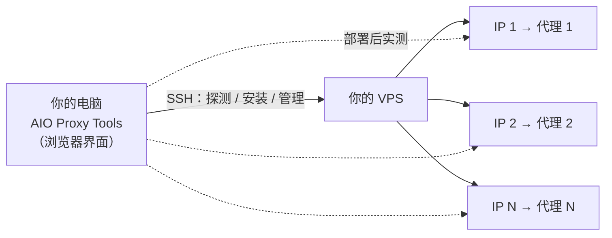

<div align="center">


# AIO Proxy Tools

**服务器上有多少个 IP，就一键搭出多少个独立代理。**

填好 SSH，程序会自动识别服务器上的全部 IP。选好协议和账号后，一键完成部署、实测和导出。

[](https://github.com/Ryan-Laws/AIO-Proxy-Tools/releases)
[](https://github.com/Ryan-Laws/AIO-Proxy-Tools/actions/workflows/ci.yml)
[](LICENSE)


[English](README.md) · **简体中文**

<br>

<picture>
  <source media="(prefers-color-scheme: dark)" srcset="docs/assets/screenshot-proxies-dark.png">
  
</picture>

</div>

---

## 为什么选 AIO Proxy Tools

手上有一台多 IP 的 VPS，想让每个 IP 都变成独立的代理，通常要做这些事：

1. 登录服务器，挨个查网卡和 IP；
2. 手写代理配置，给每个 IP 绑定端口、配置账号；
3. 改防火墙，处理 DNS；
4. 最后一个个测试代理能不能用。

几十上百个 IP 下来，既费时间，又容易出错。

**AIO Proxy Tools 把这整套流程变成几次点击。** 下载后双击运行，界面在浏览器里打开，不用安装，服务器上也不用提前准备任何东西。

| | |
|---|---|
| 🧭 **自动识别** | 系统、CPU 架构、防火墙、全部 IPv4 / IPv6，包括云服务器"网卡上是内网 IP、对外是公网 IP"的情况，以及整段路由到本机的 IP 段 |
| 🔀 **IP 一一对应** | 每个 IP 独立监听，从哪个 IP 连进来，就从哪个 IP 出去，账号互相隔离 |
| 🧩 **协议随意组合** | 仅 SOCKS5、仅 HTTP(S)、两种协议分开端口，或两种协议共用一个端口 |
| 🔑 **账号灵活** | 每个 IP 一组随机账号、全部共用一组、自己指定、导入账号表，或者不设密码、改用来源 IP 白名单 |
| 📊 **限速和流量** | 按账号限速、限制并发连接数，设置按日、周、月计算的流量额度，到期自动停用，流量实时可查 |
| 🚀 **批量部署** | 一次添加几十台服务器（支持粘贴或导入 CSV），同时部署，结果汇总在一起导出 |
| ✅ **从本机实测** | 部署完成后，从你的电脑逐个测试代理：能不能连通、出口 IP 对不对、不带密码会不会被拒绝 |
| 🛡️ **安全默认** | 不保存密码，校验 SSH 主机指纹，禁止通过代理访问内网，不在请求头里暴露来源 IP，没有任何遥测 |

## 界面预览

<table>
  <tr>
    <td width="50%"><p align="center"><b>IP 列表</b>：自动识别全部 IP 和出口公网 IP，勾选要用的</p></td>
    <td width="50%"><p align="center"><b>代理设置</b>：协议、端口、账号、限制，右侧实时预览</p></td>
  </tr>
  <tr>
    <td width="50%"><p align="center"><b>代理清单</b>：实测结果、流量用量，一键导出</p></td>
    <td width="50%"><p align="center"><b>管理</b>：服务状态、启动 / 停止 / 重启、一键卸载</p></td>
  </tr>
</table>

> 截图来自内置的演示模式，里面的地址都是文档专用的示例地址。

## 快速开始

### 1. 下载

到 [Releases](https://github.com/Ryan-Laws/AIO-Proxy-Tools/releases) 下载对应系统的压缩包，解压就能用，不需要安装任何依赖。

| 系统 | 文件 |
|---|---|
| Windows | `aio-proxy-tools-*-windows-amd64.zip`（ARM 设备选 `windows-arm64`） |
| macOS | `aio-proxy-tools-*-darwin-arm64.tar.gz`（M 系列芯片）/ `darwin-amd64`（Intel 芯片） |
| Linux | `aio-proxy-tools-*-linux-amd64.tar.gz` / `linux-arm64` |

每个版本都附带 `SHA256SUMS`，可以用来校验下载的文件是否完整。

### 2. 运行

- **Windows**：双击 `aio-proxy-tools.exe`。
- **macOS / Linux**：在终端运行 `./aio-proxy-tools`。

程序会弹出一个控制台窗口，同时自动用浏览器打开操作界面。**使用期间不要关闭这个控制台窗口**，关掉程序就退出了。

> **macOS 首次打开**：程序没有经过苹果签名，需要到"系统设置 → 隐私与安全性"里点"仍要打开"，或者在终端执行 `xattr -d com.apple.quarantine ./aio-proxy-tools`。

### 3. 部署

在界面里按顺序操作：

1. **添加服务器**：填写 IP、SSH 端口、用户名，以及密码或私钥。
2. **IP 列表**：程序自动探测完成后，勾选要做成代理的 IP。
3. **代理设置**：选好协议、端口和账号，点 **开始部署**。
4. **代理清单**：部署完成后会自动实测，在这里复制或导出结果。

不想马上连服务器、只想先看看界面的话，在首页点 **载入演示数据** 即可。

## 使用说明

### 添加服务器

- **登录方式**：支持密码或 OpenSSH 私钥（可带私钥密码）；可以直接用 root，也可以用有 sudo 权限的普通用户。
- **批量添加**：点 **添加服务器** 旁边的 `⋯`，每行粘贴一台 `地址[:端口] [用户] [密码]`（用空格分隔），或者导入 CSV 文件。添加后会自动探测。
- **主机指纹**：第一次连接时会记下服务器的主机指纹，之后如果指纹变了会拒绝连接，防止中间人攻击。确实是重装了系统的话，可以在界面里确认后重新信任。

### 选择 IP

探测完成后，IP 列表会列出：

- 每个 IP 所在的网卡、类型（v4 / v6）、来源（网卡或 AnyIP 整段路由）；
- 实际测出来的**出口公网 IP**。

可以按网段筛选、只看 IPv4 或 IPv6、只看出口正常的 IP。按住 Shift 点击可以连续勾选。

### 代理设置

| 设置项 | 可选内容 |
|---|---|
| 协议 | 仅 SOCKS5 · 仅 HTTP · 双协议分端口（推荐）· 双协议同端口 |
| 端口 | 每种协议单独设置：所有 IP **统一**一个端口 / 按 IP **递增** / **随机**。在预览表里还可以单独改某一行 |
| 账号 | 每个 IP 独立随机 · 全部共用随机 · 自定义 · 导入账号表 · 无认证（必须设置来源 IP 白名单） |
| 限制 | 每个账号的限速（Mbps）、最大并发连接数、按日 / 周 / 月计算的流量额度、到期时间 |
| DNS | 本机递归（默认）· 本机缓存 + 转发 · 公共 DNS 直连 · 系统解析 · 自定义 |
| 系统选项 | 自动放行防火墙 · 开启 BBR · 内核参数调优 · 禁止访问内网 · 重新部署时沿用原端口和账号 · 停用有冲突的其它代理 · SOCKS5 UDP（实验性）· 连接日志（默认关闭）· GitHub 镜像 |

右侧的 **部署预览** 会实时显示：将生成多少个代理、要占用哪些端口、有哪些需要注意的问题。点 **预览清单** 可以先看到每一个代理的具体参数，再决定是否部署。

设置好的组合可以点 **保存为默认**，以后添加的服务器会直接沿用。

### 部署与测试

点 **开始部署** 后，程序会通过 SSH 自动完成以下步骤，进度在 **部署日志** 里实时显示：

1. 安装 3proxy，从官方下载并校验 SHA256；
2. 装好 DNS 解析器；
3. 绑定 IP，生成配置；
4. 设置防火墙，注册成系统服务。

部署完成后，程序会自动从你的电脑测试每一个代理。如果服务器上自测正常、你的电脑却连不上，界面会明确提示你：去云厂商控制台的**安全组**里放行代理端口。

### 导出

在 **代理清单** 点 **导出**，或者在顶部点 **全部导出** 把所有服务器一起导出。支持以下格式：

- `ip:port:user:pass`
- `user:pass@ip:port`
- `socks5://user:pass@ip:port` / `http://...` 链接
- CSV 表格
- 自定义模板，例如 `{proto}://{user}:{pass}@{host}:{port}`

导出时可以只导出某一种协议，也可以只导出测试通过的代理。

### 管理与卸载

在 **管理** 页面可以：

- 查看服务状态、当前连接数、内存占用；
- 启动、停止、重启代理服务；
- 修改设置后重新部署，已经在用的连接不会断开。

点 **卸载** 会停止服务、删除文件，并撤销本工具添加的防火墙规则和 IP 绑定，把服务器恢复到部署前的样子。

## 命令行模式

没有桌面环境的机器，或者需要写进自动化脚本时，可以直接用命令行：

```bash
export AIO_SSH_PASSWORD='你的SSH密码'      # 从环境变量读取，不会留在命令历史里
./aio-proxy-tools deploy -host 203.0.113.10 -protocol dual -auth per -out proxies.txt
./aio-proxy-tools test -host 203.0.113.10
./aio-proxy-tools uninstall -host 203.0.113.10
```

常用参数：

| 参数 | 说明 | 默认值 |
|---|---|---|
| `-host` | 服务器地址（必填） | |
| `-port` / `-user` / `-key` | SSH 端口、用户、私钥文件 | `22` / `root` / 无 |
| `-protocol` | `socks` · `http` · `dual` · `auto` | `dual` |
| `-socks-port` / `-http-port` | 统一端口模式下的端口 | `1080` / `8080` |
| `-port-mode` | `same` 统一 · `inc` 递增 · `random` 随机 | `same` |
| `-auth` | `per` 每 IP 独立 · `shared` 共用 · `custom` 自定义 · `none` 无认证 | `per` |
| `-whitelist` | 来源 IP 白名单（逗号分隔，IP 或网段），`-auth none` 时必填 | 空 |
| `-ips` | 只用这些 IP（逗号分隔），留空表示使用所有出口正常的 IPv4 | 空 |
| `-speed` / `-max-conn` / `-quota` | 每个账号的限速（Mbps）/ 最大并发 / 每月流量（GB），`0` 表示不限 | `0` |
| `-dns` | `recursive` · `forward` · `public` · `system` | `recursive` |
| `-out` / `-json` | 把结果写成 `ip:port:user:pass` 文本或 JSON 文件 | |

运行 `./aio-proxy-tools deploy -h` 可以查看全部参数。

## 工作原理



- **代理程序**：[3proxy](https://github.com/3proxy/3proxy)，轻量、稳定、资源占用小。每个 IP 单独监听，出口和入口是同一个 IP。
- **服务器上的布局**：使用独立的目录（`/etc/aio-proxy`、`/opt/aio-proxy`）和独立的服务名（`aio-proxy`），以非 root 用户运行，不会影响服务器上已有的其它程序。
- **支持的服务器**：
  - 系统：Debian / Ubuntu / CentOS / Rocky / Alma / Fedora / Alpine / Arch / openSUSE 等主流发行版；
  - 包管理器：apt、dnf、yum、apk、pacman、zypper；
  - 服务管理：systemd 和 OpenRC；
  - 架构：x86_64、ARM64、ARMv7。
- **DNS**：默认在服务器上运行一个只供本机使用的 unbound 解析器，直接从根服务器查询。这样目标网站看到的 DNS 来源和代理在同一个机房，也不会把服务器的主 IP 段泄露给第三方。如果机房封了 53 端口，会自动改为转发到 1.1.1.1 和 9.9.9.9，这两个公共 DNS 都不会附带子网信息。

## 常见问题

<details>
<summary><b>服务器上自测通过，为什么我的电脑连不上？</b></summary>

绝大多数情况是云厂商控制台里的**安全组 / 防火墙**没有放行代理端口。安全组没法通过 SSH 修改，需要你自己到控制台放行。程序会列出需要放行的端口。
</details>

<details>
<summary><b>DNS 会不会泄露？</b></summary>

客户端请使用 `socks5h://`，或者在客户端里设置"由代理解析域名"。否则域名会在你自己的电脑上解析，服务器那边怎么配置都没用。服务器端默认使用本机递归解析，详见上面的"工作原理"。
</details>

<details>
<summary><b>限速和流量额度是按 IP 算，还是按账号算？</b></summary>

按账号算。想让每个 IP 单独限制的话，账号模式请选"每 IP 独立随机"。
</details>

<details>
<summary><b>会不会影响服务器上已有的服务？</b></summary>

不会覆盖已有的 3proxy、sing-box 等程序。部署前会检查端口冲突；只有你明确勾选，才会停用有冲突的服务。卸载时会撤销本工具做过的所有改动。
</details>

<details>
<summary><b>服务器连不上 GitHub，还能装 3proxy 吗？</b></summary>

可以。程序会依次尝试三种办法：

1. 优先用 3proxy 官方的 deb / rpm 安装包；
2. 系统不支持官方包时，下载官方源码在服务器上编译；
3. 服务器连不上 GitHub 时，改由你的电脑下载，再上传到服务器。下载会使用你电脑上的 `HTTPS_PROXY` 环境变量；也可以在设置里填一个 GitHub 镜像地址（只接受 https）。

无论哪种办法，文件都要和**程序内置的官方 SHA256** 一致才会使用。校验值写死在程序里，不依赖下载来的校验文件，所以镜像或中间人无法替换安装包。

</details>

<details>
<summary><b>密码保存在哪里？</b></summary>

默认不保存，SSH 密码只留在内存里，关闭程序就清除了。如果你开启"记住密码"，密码会用你设置的主密码加密保存（scrypt + AES-256-GCM），主密码本身不会写到磁盘上。
</details>

## 安全与隐私

- **只有本机能打开界面**：操作界面只监听 `127.0.0.1`，每次启动都会生成随机访问令牌，并校验 Host 头，防止 DNS 重绑定攻击。
- **本机只保存很少的信息**：只保存服务器地址、用户名（可以关闭）和 SSH 主机指纹。数据目录位置：
  - Windows：`%AppData%\aio-proxy-tools`
  - macOS：`~/Library/Application Support/aio-proxy-tools`
  - Linux：`~/.config/aio-proxy-tools`
- **服务器端**：
  - 3proxy 以单独的非 root 用户运行；
  - 始终禁止通过代理访问服务器自己的地址、本机回环和云厂商元数据服务；默认还禁止访问内网地址；
  - HTTP 代理不会添加 `X-Forwarded-For` 这类暴露来源 IP 的请求头；
  - 默认不记录连接日志。
- **没有遥测**：程序不会收集或上传任何使用数据，也不会联网检查更新。

## 从源码构建

需要 Go 1.26 以上和 Node.js 20 以上。

```bash
./build.sh v1.0.0                  # Linux / macOS，产物在 dist/
pwsh ./build.ps1 -Version v1.0.0   # Windows
```

开发调试：

```bash
go run ./cmd/aio-proxy-tools -dev   # 后端，固定端口 17890
cd web && npm run dev               # 前端开发服务器（请求转发到后端）
cd web && npm run dev:mock          # 演示模式，不需要后端和服务器
go test ./...
```

<details>
<summary>项目结构</summary>

```
cmd/aio-proxy-tools/   程序入口（图形界面 + 命令行）
internal/
  app/         业务编排：服务器、任务、部署流程
  sshx/        SSH 连接、sudo、脚本执行、主机指纹校验
  detect/      解析服务器探测结果
  plan/        端口和账号分配、参数校验
  threeproxy/  生成 3proxy / unbound 配置，解析流量统计
  tester/      从本机测试代理
  store/       本机设置和加密保存的密码
  web/         本地 HTTP API 与 SSE
scripts/       在服务器上执行的 POSIX sh 脚本（探测 / 安装 / 卸载 / 运维）
web/           前端（React + Vite + TypeScript + shadcn/ui）
docs/          设计文档与 API 说明
test/e2e/      在真实 Linux 上运行的端到端测试（GitHub Actions）
```
</details>

设计细节见 [docs/DESIGN.md](docs/DESIGN.md)，本地接口说明见 [docs/API.md](docs/API.md)。

## 免责声明

本项目只用于在**你自己拥有或已经获得授权**的服务器上搭建代理。请遵守当地法律法规和服务商的使用条款，使用本工具产生的一切后果由使用者自行承担。

## 许可证

[MIT](LICENSE)。3proxy 是独立的开源项目，有自己的许可证。部署时会从它的官方渠道获取，不随本程序一起分发。
